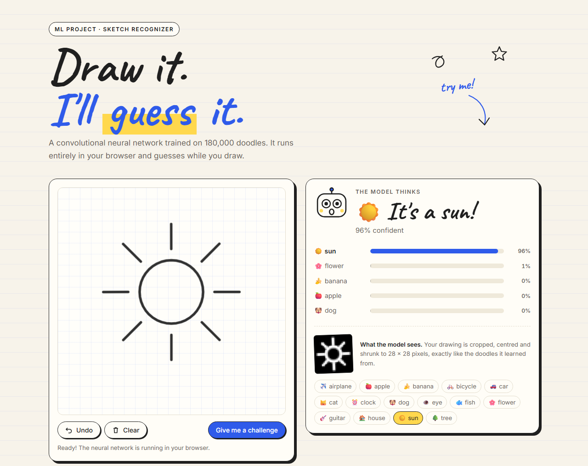
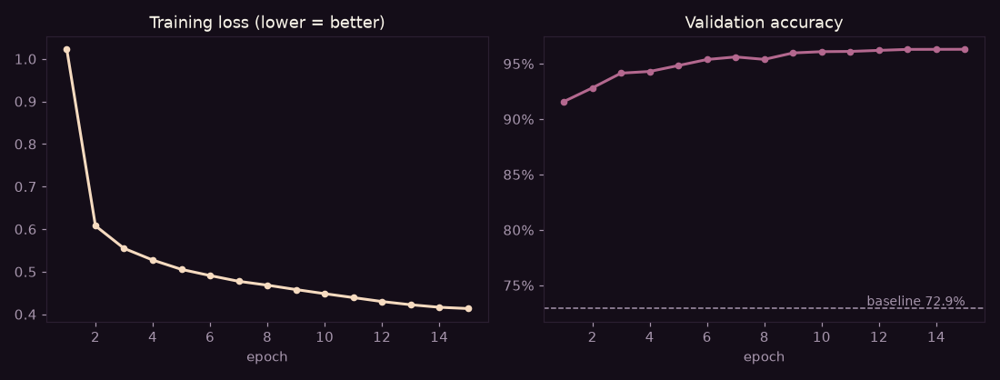
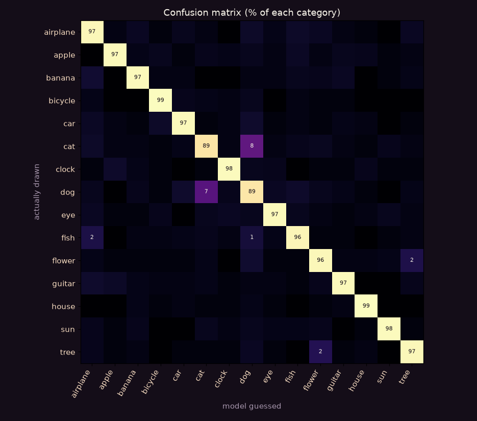
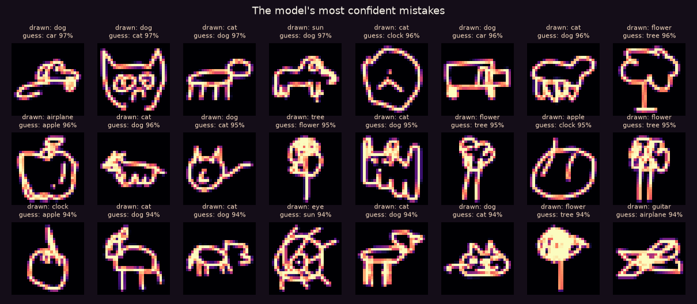
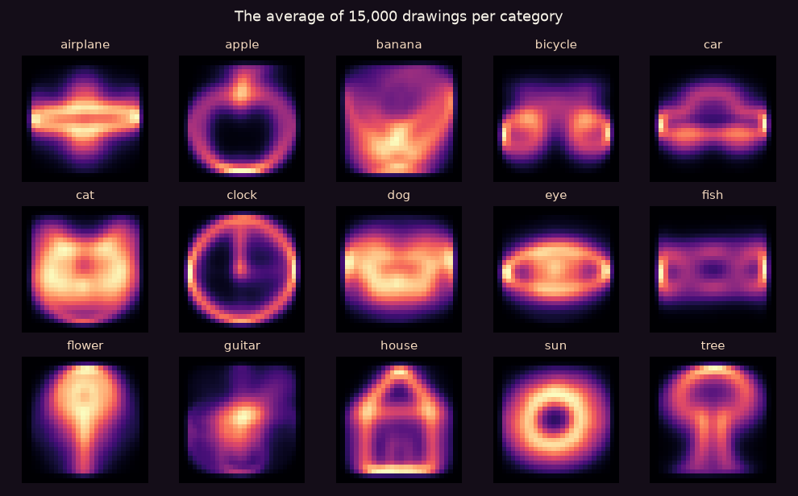
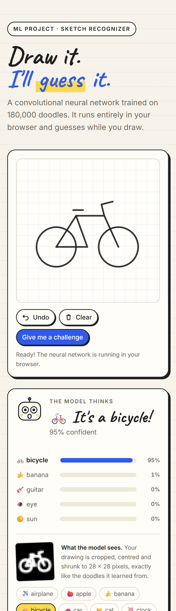

# ✏️ Sketch Recognizer

**Draw something. A neural network guesses what it is, live, while you draw.**

### ▶ [Try it live: sketch-recognizer.vercel.app](https://sketch-recognizer.vercel.app)

My second machine learning project, and my first deep learning one. I trained a convolutional neural network (CNN) on 180,000 real doodles, then exported it so it runs entirely in the browser. There's no server: your drawing never leaves your device.



## What it does

Draw on the graph paper and the model guesses among 15 things: airplane, apple, banana, bicycle, car, cat, clock, dog, eye, fish, flower, guitar, house, sun and tree. It updates on every stroke, shows its top 5 guesses, and shows you the tiny 28 × 28 image it actually "sees".

There's also a challenge mode. It asks you to draw something, and **Doodle Bot**, the little mascot, reacts to how sure the model is. Its eyes follow your pencil.

## Results

All numbers are on **22,500 test drawings the model never saw** during training or tuning.

| Model | Test accuracy |
|---|---:|
| Random guess | 6.7% |
| Logistic regression (baseline) | 72.9% |
| **CNN (this project)** | **96.2%** |

The right answer is in the CNN's top 3 guesses **98.9%** of the time.



**Easiest categories:** house (99.0%) and bicycle (98.6%). **Hardest:** cat (89.0%) and dog (89.4%), which get confused with each other about 8% of the time. That makes sense: a 20-second cat and a 20-second dog are both "four legs, a head and a tail".



## The most interesting thing I found

I looked at the model's most confident *mistakes*, and many of them aren't mistakes at all:



A drawing labelled "airplane" is clearly an apple. One labelled "sun" is clearly a dog. One labelled "clock" is an apple. The original game sometimes saved drawings under the wrong word. This is called **label noise**: for a lot of its "errors", the model is right and the dataset is wrong. So the real accuracy is a bit higher than 96.2%. I wouldn't have found this by looking only at the numbers.

## How it works

1. **Data:** the first 15,000 drawings of each category from Google's [Quick, Draw!](https://github.com/googlecreativelab/quickdraw-dataset) dataset, already rendered as 28 × 28 grayscale images. Before training anything, I averaged each category to see the "typical" drawing:

   

2. **Split:** 80% for training, 10% for validation (to make choices), and 10% for the final test, used once.
3. **Model:** three convolution blocks (conv → batch norm → ReLU, twice, then max-pool), followed by a small classifier with dropout. That's 586k parameters, 2.3 MB.
4. **Training:** 15 epochs with AdamW and a one-cycle learning-rate schedule, on an RTX 4060 (about 2.5 minutes). **Data augmentation** randomly tilts, shifts and resizes every drawing, because people never draw things in exactly the same place.
5. **Export:** PyTorch → ONNX, checked against PyTorch on 2,000 drawings (same answer 100% of the time).
6. **Web app:** [ONNX Runtime Web](https://onnxruntime.ai/) runs the model in the browser. The trickiest part was preparing the drawing exactly like the training data: I measured that Quick, Draw! doodles fill about 26 of the 28 pixels and are centred, so the app crops, scales and centres your drawing the same way.



## What I learned

- **A CNN understands shapes; a simple model doesn't.** Logistic regression sees 784 separate pixels and gets 72.9%. The CNN sees strokes, curves and parts, and gets 96.2%.
- **Validation and test sets keep you honest.** Validation was 96.3% and test 96.2%, so the model really generalizes to new drawings.
- **Look at your mistakes, not just your score.** That's how I found the label noise.
- **The model is only half the product.** Matching the browser drawing to the training format mattered as much as the network itself.

## Limits

- It only knows 15 things. Draw a giraffe and it will still pick one of the 15.
- Cat vs dog is its weak spot.
- Quick, Draw! drawings are fast and simple, so very detailed drawings can confuse it.

## Run it yourself

The web app needs no install. Serve the `demo/` folder with any static server, for example:

```
python -m http.server 8000 --directory demo
```

Then open http://localhost:8000. Add `?demo=sun` (or `house`, `bicycle`) to the address to start with a sample drawing.

To retrain the model:

```
python -m venv .venv
.venv\Scripts\python.exe -m pip install torch --index-url https://download.pytorch.org/whl/cu126
.venv\Scripts\python.exe -m pip install numpy matplotlib scikit-learn onnx onnxruntime
```

| Script | What it does |
|---|---|
| `00_download.py` | Downloads the first 15,000 drawings of each category (about 180 MB, not in this repo) |
| `01_explore.py` | Example drawings and average drawings per category |
| `02_baseline.py` | Random and logistic regression baselines |
| `03_train.py` | Trains the CNN (uses the GPU if there is one) |
| `04_evaluate.py` | Test accuracy, confusion matrix, gallery of mistakes |
| `05_export.py` | Exports to ONNX and checks it matches PyTorch |

## Built with

Python · PyTorch · NumPy · scikit-learn · matplotlib · ONNX · ONNX Runtime Web · plain HTML, CSS and JavaScript

## Credits

Drawings from the [Quick, Draw! dataset](https://github.com/googlecreativelab/quickdraw-dataset) by Google, licensed under [CC BY 4.0](https://creativecommons.org/licenses/by/4.0/).
